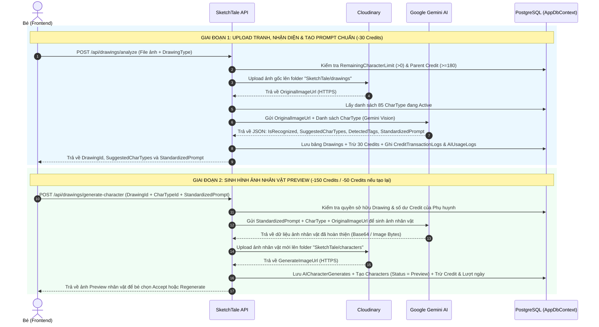

# 🎨 Tài Liệu Thiết Kế Luồng AI 2 Giai Đoạn: Quét Tranh Vẽ (Drawing) & Tạo Nhân Vật (Character Generation)

> **Mục đích tài liệu:** Tài liệu này tổng hợp chi tiết luồng hoạt động 2 giai đoạn của AI, dữ liệu đầu vào/đầu ra (Input/Output) của từng API, cấu trúc tổ chức code trong `sketch_tale.sln` và hướng dẫn đăng ký **Google Gemini API Key** để cả nhóm (Backend & Frontend) thống nhất trước khi code chính thức vào dự án.

---

## 1. Tổng Quan Luồng Đi Của Hệ Thống (2 Giai Đoạn AI)

Hệ thống chia quá trình biến bức tranh vẽ tay của bé thành nhân vật trong truyện thành **2 giai đoạn tách biệt** nhằm tối ưu trải nghiệm người dùng, kiểm soát chặt chẽ chi phí Credit của Phụ huynh và đảm bảo an toàn nội dung cho trẻ em.



### Giải thích chi tiết từng giai đoạn:

1. **Giai đoạn 1 — Quét tranh & Tạo câu Prompt chuẩn (`POST /api/drawings/analyze`):**
   - **Kiểm tra điều kiện trước khi chạy:**
     - Kiểm tra bé còn lượt tạo nhân vật trong ngày không (`ChildProfile.RemainingCharacterLimit > 0`).
     - Kiểm tra phụ huynh còn đủ tối thiểu **180 Credits** không (`30 credits` cho bước phân loại ảnh + `150 credits` dự phòng cho bước tạo nhân vật kế tiếp) để tránh việc bé bị trừ 30 credits xong lại không đủ credit tạo nhân vật.
   - **Xử lý hình ảnh & AI Vision:**
     - Upload bức tranh của bé lên Cloudinary (`SketchTale/drawings`) để lấy `OriginalImageUrl`.
     - Gửi ảnh cùng danh sách 85 `CharType` trong Database sang **Gemini Flash (Multimodal Vision)**.
     - AI thực hiện **3 nhiệm vụ trong 1 lần gọi**:
       1. Nhận diện nét vẽ của bé là con vật/đồ vật gì và lọc ra `1 - 3` loại `CharType` khớp nhất trong DB.
       2. Trích xuất các từ khóa đặc điểm (`DetectedTags`: màu sắc chủ đạo, biểu cảm, tư thế).
       3. **Sinh sẵn câu `StandardizedPrompt` (bằng tiếng Anh chuẩn)** mô tả chi tiết nhân vật dựa trên đúng màu sắc và nét vẽ của bé để dùng cho Giai đoạn 2.
   - **Xử lý khi AI không nhận diện được (`IsRecognized = false`):**
     - Frontend mở màn hình **Fallback** theo đúng Activity Diagram: Cho phép bé gửi lại ảnh (`Resend Photo`), hoặc nhập/nói mô tả (`ChildAdditionalIdea`) và chọn nhanh một `CharType` theo độ tuổi.

2. **Giai đoạn 2 — Sinh hình ảnh nhân vật từ Prompt chuẩn (`POST /api/drawings/generate-character`):**
   - Bé chọn 1 `CharTypeId` (từ danh sách gợi ý ở Giai đoạn 1 hoặc từ màn hình Fallback) và gửi kèm `DrawingId` + `StandardizedPrompt` lên hệ thống.
   - Hệ thống kết hợp `StandardizedPrompt` + tên `CharType` (và `ChildAdditionalIdea` nếu có) để gọi AI sinh ra hình ảnh minh họa nhân vật 2D phong cách sách truyện thiếu nhi trên nền trắng.
   - Ảnh sinh ra được đẩy lên Cloudinary (`SketchTale/characters`), lưu vào bảng `AICharacterGenerate` và khởi tạo bản ghi `Character` ở trạng thái `Preview`.
   - Trừ **150 Credits** nếu tạo lần đầu (`IsRegenerate = false`) hoặc **50 Credits** nếu tạo lại (`IsRegenerate = true`).

---

## 2. Chi Tiết Dữ Liệu Nhận Vào (Input) & Trả Ra (Output)

### 2.1. Giai đoạn 1: API Quét & Phân Tích Tranh Vẽ
- **Endpoint:** `POST /api/drawings/analyze`
- **Headers:** `Authorization: Bearer <Child_JWT_Token>`
- **Content-Type:** `multipart/form-data`

#### 📥 Nhận vào (Input - Form Data):
| Tên trường | Kiểu dữ liệu | Bắt buộc | Mô tả |
| :--- | :--- | :---: | :--- |
| `File` | `IFormFile` | Có | File ảnh vẽ từ Canvas xuất ra hoặc ảnh chụp tải lên (`.png`, `.jpg`, `.jpeg`, `.webp`, tối đa 10MB). |
| `DrawingType` | `Enum (string/int)` | Có | `Canvas` (`0`) nếu vẽ trực tiếp trên app, hoặc `Uploaded` (`1`) nếu chụp/tải ảnh lên. |

*(Lưu ý: `ChildProfileId` được Backend tự động lấy từ JWT Token của bé thông qua `ICurrentUserService`, Frontend không cần truyền).*

#### 📤 Trả ra (Output - JSON `200 OK`):
```json
{
  "drawingId": "3fa85f64-5717-4562-b3fc-2c963f66afa6",
  "originalImageUrl": "https://res.cloudinary.com/jobuofoo/image/upload/v1730000000/SketchTale/drawings/sketch_01.png",
  "drawingType": "Canvas",
  "isRecognized": true,
  "suggestedCharTypes": [
    {
      "id": "a1b2c3d4-1111-2222-3333-444455556666",
      "name": "mèo",
      "description": "Kiểu nhân vật mèo",
      "status": "Active"
    },
    {
      "id": "b2c3d4e5-1111-2222-3333-444455556666",
      "name": "hổ",
      "description": "Kiểu nhân vật hổ",
      "status": "Active"
    }
  ],
  "detectedTags": [
    "orange fur",
    "striped tail",
    "smiling face",
    "standing posture"
  ],
  "standardizedPrompt": "A cute 2D children's storybook illustration of a friendly orange cat with striped tail and a big cheerful smile, standing posture, preserving the child's hand-drawn color palette, isolated on a pure solid white background, vibrant colors, Pixar/Disney picture book style, child-safe.",
  "remainingParentCredits": 3690,
  "remainingDailyCharacterLimit": 1
}
```

---

### 2.2. Giai đoạn 2: API Sinh Hình Ảnh Nhân Vật (Preview / Regenerate)
- **Endpoint:** `POST /api/drawings/generate-character`
- **Headers:** `Authorization: Bearer <Child_JWT_Token>`
- **Content-Type:** `application/json`

#### 📥 Nhận vào (Input - JSON Body):
```json
{
  "drawingId": "3fa85f64-5717-4562-b3fc-2c963f66afa6",
  "charTypeId": "a1b2c3d4-1111-2222-3333-444455556666",
  "standardizedPrompt": "A cute 2D children's storybook illustration of a friendly orange cat with striped tail and a big cheerful smile, standing posture, preserving the child's hand-drawn color palette, isolated on a pure solid white background, vibrant colors, Pixar/Disney picture book style, child-safe.",
  "childAdditionalIdea": "Mặc thêm áo choàng siêu nhân màu đỏ",
  "detectedTags": [
    "orange fur",
    "striped tail",
    "smiling face"
  ],
  "isRegenerate": false
}
```

| Tên trường | Kiểu dữ liệu | Bắt buộc | Mô tả |
| :--- | :--- | :---: | :--- |
| `drawingId` | `Guid` | Có | ID của bức tranh đã lưu ở Giai đoạn 1. |
| `charTypeId` | `Guid` | Có | ID của loại nhân vật bé đã chốt chọn. |
| `standardizedPrompt` | `string?` | Không | Câu prompt chuẩn nhận được từ Giai đoạn 1. Nếu trống, Backend tự tạo prompt mặc định từ `charTypeId`. |
| `childAdditionalIdea` | `string?` | Không | Mô tả thêm bằng giọng nói/văn bản của bé (nếu có). |
| `detectedTags` | `List<string>?` | Không | Danh sách tag nhận diện từ Giai đoạn 1 để lưu vào `AICharacterGenerate.AIDetectedTagsJson`. |
| `isRegenerate` | `bool` | Có | `false`: Tạo lần đầu (-150 credits). `true`: Tạo lại (-50 credits). |

#### 📤 Trả ra (Output - JSON `200 OK`):
```json
{
  "aiCharacterGenerateId": "9c8b7a65-4321-4562-b3fc-2c963f66afa6",
  "characterId": "7d6e5f43-1234-4562-b3fc-2c963f66afa6",
  "drawingId": "3fa85f64-5717-4562-b3fc-2c963f66afa6",
  "charTypeId": "a1b2c3d4-1111-2222-3333-444455556666",
  "aiPromptUsed": "A cute 2D children's storybook illustration of a friendly orange cat... Confirmed character type: 'mèo'. Child's additional description: Mặc thêm áo choàng siêu nhân màu đỏ.",
  "generateImageUrl": "https://res.cloudinary.com/jobuofoo/image/upload/v1730000050/SketchTale/characters/char_a1b2c3.png",
  "aiGenStatus": "Success",
  "characterStatus": "Preview",
  "remainingParentCredits": 3540,
  "remainingDailyCharacterLimit": 0
}
```

---

## 3. Cấu Trúc Khi Đưa AI Vào Solution (`sketch_tale.sln`)

Để tuân thủ đúng kiến trúc **Clean Architecture** hiện tại của dự án, các file mới được phân bổ vào 4 tầng như sau:

```text
sketch_tale.sln
│
├── 📁 sketch_tale.Domain (Không cần sửa cấu trúc bảng, giữ nguyên các Entity đã có)
│   ├── Entities/
│   │   ├── Drawing.cs                  (Lưu bức tranh gốc của bé)
│   │   ├── AICharacterGenerate.cs      (Lưu Prompt chuẩn, Tags JSON, URL ảnh AI sinh ra)
│   │   ├── Character.cs                (Lưu nhân vật ở trạng thái Preview -> Pending -> Approved)
│   │   ├── CharType.cs                 (Danh mục 85 loại nhân vật mẫu)
│   │   ├── CreditCost.cs               (Chi phí: 30 / 150 / 50 credits)
│   │   ├── CreditTransactionLog.cs     (Lịch sử trừ credit của phụ huynh)
│   │   └── AIUsageLog.cs               (Lịch sử tiêu thụ Token & chi phí gọi Gemini API)
│
├── 📁 sketch_tale.Application (Chứa DTOs, Interfaces và Logic điều phối nghiệp vụ)
│   ├── DTOs/
│   │   └── 🆕 DrawingAiDtos.cs         (Chứa Request/Response DTO cho Giai đoạn 1 & Giai đoạn 2)
│   ├── Interfaces/
│   │   ├── Repositories/
│   │   │   └── 🆕 IDrawingRepository.cs
│   │   └── Services/
│   │       ├── 🆕 IAiCharacterService.cs              (Interface gọi AI Gemini)
│   │       └── 🆕 IDrawingCharacterWorkflowService.cs (Interface điều phối luồng Drawing -> Character)
│   └── Services/
│       └── 🆕 DrawingCharacterWorkflowService.cs      (Xử lý: Check limit -> Upload -> Gọi AI -> Trừ Credit -> Lưu DB)
│
├── 📁 sketch_tale.Infrastructure (Chứa kết nối Database, Cloudinary và Gemini AI)
│   ├── Settings/
│   │   └── 🆕 GeminiAiSettings.cs      (Map cấu hình ApiKey, VisionModel, ImageModel từ appsettings.json)
│   ├── Repositories/
│   │   ├── 🆕 DrawingRepository.cs
│   │   └── UnitOfWork.cs               (Cập nhật thêm DrawingRepository)
│   └── Services/
│       ├── CloudinaryService.cs        (Upload tranh gốc & ảnh nhân vật AI)
│       └── 🆕 GeminiAiCharacterService.cs (Gọi trực tiếp REST API của Google Gemini cho GĐ1 & GĐ2)
│
└── 📁 sketch_tale.API (Tầng giao tiếp với Frontend)
    ├── Controllers/
    │   └── 🆕 DrawingController.cs     (Cung cấp API /api/drawings/analyze và /api/drawings/generate-character)
    ├── appsettings.json                (Thêm cấu hình "GeminiSettings")
    └── Program.cs                      (Đăng ký DI cho HttpClient, GeminiAiCharacterService, DrawingCharacterWorkflowService)
```

---

## 4. Hướng Dẫn Đăng Ký & Cấu Hình API Key Của Google Gemini

Để sử dụng cả 2 giai đoạn với chi phí thấp và tốc độ nhanh nhất, nhóm nên sử dụng **Google AI Studio (Gemini API)**:
- **Giai đoạn 1 (Quét tranh & Tạo Prompt):** Dùng model **`gemini-2.5-flash`** (hoặc `gemini-2.0-flash`) — Có gói **Free Tier** miễn phí mỗi ngày, tốc độ nhận diện ảnh cực nhanh (1–2 giây) và hỗ trợ trả về chuẩn JSON (`responseMimeType: "application/json"`).
- **Giai đoạn 2 (Sinh hình ảnh nhân vật):** Dùng model **`gemini-2.0-flash-preview-image-generation`** (hoặc **`imagen-3.0-generate-002`**) trên cùng 1 API Key của Google Gemini.

### Bước 1: Tạo Gemini API Key trên Google AI Studio
1. Truy cập trang chủ Google AI Studio: https://aistudio.google.com/
2. Đăng nhập bằng tài khoản Google (Gmail) của nhóm.
3. Nhìn thanh menu bên trái, bấm vào mục **"Get API key"** (hoặc truy cập trực tiếp https://aistudio.google.com/app/apikey).
4. Bấm nút **"Create API key"**.
5. Chọn **"Create API key in new project"** (hoặc chọn Google Cloud Project có sẵn của nhóm).
6. Copy chuỗi API Key vừa sinh ra (bắt đầu bằng `AIzaSy...`) và cất giữ cẩn thận.

> **Lưu ý về hạn mức (Quota) của Gemini:**
> - Với **Giai đoạn 1 (`gemini-2.5-flash`)**: Gói Free Tier cho phép tới **15 requests/phút** và **1,500 requests/ngày** hoàn toàn miễn phí — dư sức cho cả nhóm test đồ án.
> - Với **Giai đoạn 2 (Image Generation)**: Một số model tạo ảnh chuyên sâu như `imagen-3.0` yêu cầu liên kết tài khoản thanh toán (Pay-as-you-go / Google Cloud Free Trial \$300) hoặc dùng `gemini-2.0-flash-preview-image-generation`. Trong code Base của dự án đã có sẵn **chế độ Mock tự động** khi chưa nạp tiền hoặc chưa điền Key để nhóm vẫn test luồng Database/Frontend trơn tru 100%.

### Bước 2: Đưa API Key vào file cấu hình `appsettings.json`
Mở file `sketch_tale.API/appsettings.json` và thêm mục `"GeminiSettings"` như sau:

```json
{
  "GeminiSettings": {
    "ApiKey": "AIzaSy_DAN_API_KEY_CUA_NHOM_Vao_DAY",
    "VisionModel": "gemini-2.5-flash",
    "ImageGenerationModel": "gemini-2.0-flash-preview-image-generation"
  }
}
```

*(Khi đẩy code lên GitHub, nhóm để trống `"ApiKey": ""` trong `appsettings.json` và điền key thật vào `appsettings.Development.json` hoặc biến môi trường `GeminiSettings__ApiKey` trên server triển khai để tránh bị lộ key).*

---

## 5. Checklist Để Nhóm Chốt Trước Khi Thực Thi Code

- [ ] **Chốt tên 2 Endpoint:** `POST /api/drawings/analyze` (Giai đoạn 1) và `POST /api/drawings/generate-character` (Giai đoạn 2).
- [ ] **Chốt quy tắc trừ Credit:**
  - Giai đoạn 1 (Phân loại tranh): **-30 Credits** (chỉ trừ khi AI quét thành công).
  - Giai đoạn 2 (Tạo nhân vật lần đầu): **-150 Credits** và trừ **1 lượt tạo nhân vật trong ngày** của bé.
  - Giai đoạn 2 (Bấm tạo lại - Regenerate): **-50 Credits** và **không trừ thêm** lượt tạo trong ngày.
- [ ] **Chốt nhà cung cấp AI:** Sử dụng **Google Gemini API** cho cả 2 giai đoạn (kèm chế độ Fallback/Mock khi chạy local chưa có key).

