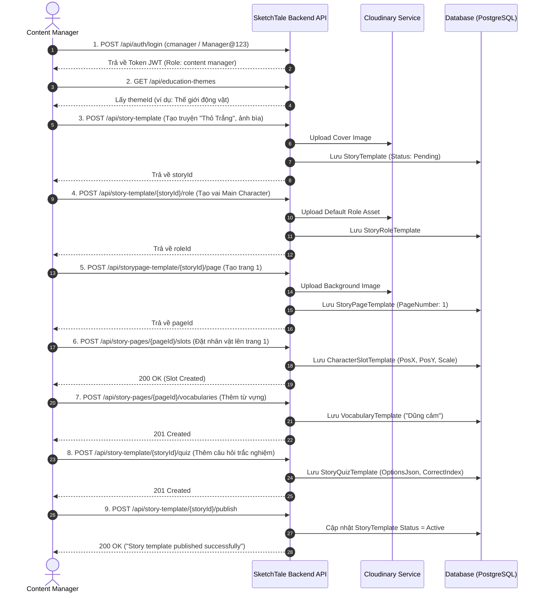

# CẨM NANG TOÀN TẬP: HƯỚNG DẪN SỬ DỤNG VÀ TEST API CONTENT MANAGER (SKETCH-TALE)

> **Tài liệu dành cho**: Content Manager, Backend Developer, Frontend/Mobile Developer và QA/Tester.  
> **Mục tiêu**: Hướng dẫn chi tiết quy trình nghiệp vụ, thông số kỹ thuật từng API, kịch bản kiểm thử End-to-End (E2E) và cách xử lý các lỗi thường gặp khi quản lý nội dung truyện template trên hệ thống SketchTale.

---

## MỤC LỤC
1. [Tổng quan về vai trò Content Manager & Vòng đời truyện](#1-tổng-quan-về-vai-trò-content-manager--vòng-đời-truyện)
2. [Tài khoản kiểm thử & Cơ chế xác thực](#2-tài-khoản-kiểm-thử--cơ-chế-xác-thực)
3. [Quy trình 8 bước tạo một bộ truyện hoàn chỉnh](#3-quy-trình-8-bước-tạo-một-bộ-truyện-hoàn-chỉnh)
4. [Bảng tra cứu nhanh các Endpoint](#4-bảng-tra-cứu-nhanh-các-endpoint)
5. [Chi tiết từng nhóm API & Payload mẫu](#5-chi-tiết-từng-nhóm-api--payload-mẫu)
   - [5.1 Xác thực (Auth API)](#51-xác-thực-auth-api)
   - [5.2 Chủ đề giáo dục (Education Theme API)](#52-chủ-đề-giáo-dục-education-theme-api)
   - [5.3 Upload Media (Upload API)](#53-upload-media-upload-api)
   - [5.4 Quản lý khung truyện (Story Template API)](#54-quản-lý-khung-truyện-story-template-api)
   - [5.5 Quản lý nhân vật trong truyện (Story Role Template API)](#55-quản-lý-nhân-vật-trong-truyện-story-role-template-api)
   - [5.6 Quản lý trang truyện (Story Page Template API)](#56-quản-lý-trang-truyện-story-page-template-api)
   - [5.7 Đặt vị trí nhân vật trên trang (Character Slot Template API)](#57-đặt-vị-trí-nhân-vật-trên-trang-character-slot-template-api)
   - [5.8 Quản lý từ vựng học tập (Vocabulary Template API)](#58-quản-lý-từ-vựng-học-tập-vocabulary-template-api)
   - [5.9 Quản lý câu hỏi trắc nghiệm (Story Quiz Template API)](#59-quản-lý-câu-hỏi-trắc-nghiệm-story-quiz-template-api)
   - [5.10 Xuất bản truyện (Publishing API)](#510-xuất-bản-truyện-publishing-api)
6. [Kịch bản kiểm thử mẫu từ A đến Z (E2E Walkthrough)](#6-kịch-bản-kiểm-thử-mẫu-từ-a-đến-z-e2e-walkthrough)
7. [Bảng mã lỗi (HTTP Status Codes) & Lưu ý đặc biệt](#7-bảng-mã-lỗi-http-status-codes--lưu-ý-đặc-biệt)

---

## 1. Tổng quan về vai trò Content Manager & Vòng đời truyện

Trong hệ sinh thái **SketchTale**, **Content Manager** đóng vai trò kiến trúc sư nội dung. Họ tạo ra các bộ "khung truyện mẫu" (Story Template) chuẩn mực để:
- Trẻ em có thể hóa thân vào các nhân vật chính (`MainCharacter`) bằng chính những nét vẽ sáng tạo của mình.
- Hệ thống AI ghép nhân vật bé vẽ vào các vị trí đã định sẵn (`CharacterSlotTemplate`) trên các trang truyện (`StoryPageTemplate`).
- Cung cấp từ vựng nổi bật (`VocabularyTemplate`) trên từng trang để bé phát triển ngôn ngữ.
- Cung cấp các câu đố trắc nghiệm tương tác (`StoryQuizTemplate`) ở cuối truyện để ôn tập kiến thức.

### Sơ đồ cấu trúc một cuốn truyện mẫu:
```
[Education Theme (Chủ đề giáo dục: Động vật, Lòng dũng cảm...)]
       │
       ▼
[StoryTemplate (Khung truyện: Tiêu đề, Bìa, Độ tuổi, Trạng thái)]
  ├── [StoryRoleTemplates (Nhân vật: Thỏ Trắng - Main, Bác Gấu - Companion...)]
  │
  ├── [StoryPageTemplates (Các trang truyện: Trang 1, Trang 2...)]
  │      ├── [CharacterSlotTemplates (Tọa độ X, Y, Scale nhân vật trên trang)]
  │      └── [VocabularyTemplates (Từ mới: "Brave", "Forest"... trên trang)]
  │
  └── [StoryQuizTemplates (Câu đố: Câu hỏi, Ảnh minh họa, 4 Đáp án, Đáp án đúng)]
```

---

## 2. Tài khoản kiểm thử & Cơ chế xác thực

Hệ thống đã cấu hình tài khoản Content Manager mặc định trong [SeedData.cs](file:///d:/SEP490/sketch-tale-backend/sketch_tale.Infrastructure/Data/SeedData.cs):

| Thông tin | Giá trị |
|:---|:---|
| **Username** | `cmanager` |
| **Email** | `cmanager@sketch.tale.com` |
| **Password** | `Manager@123` |
| **Role trong Token** | `content manager` |

### Cơ chế gắn Token vào Request:
Sau khi đăng nhập thành công, bạn sẽ nhận được chuỗi `accessToken`. Mọi request tiếp theo (đặc biệt là các API có `[Authorize(Roles = "content manager")]`) bắt buộc phải đính kèm Header:
```http
Authorization: Bearer <access_token_vừa_nhận>
```

---

## 3. Quy trình 8 bước tạo một bộ truyện hoàn chỉnh

Khi kiểm thử hoặc sử dụng thực tế, Content Manager cần thao tác theo đúng thứ tự tuần tự sau:

1. **Bước 1**: Đăng nhập lấy `accessToken`.
2. **Bước 2**: Lấy danh sách hoặc tạo mới một **Chủ đề giáo dục** (`EducationThemeId`).
3. **Bước 3**: Tạo **StoryTemplate** (khung truyện cơ bản kèm ảnh bìa) -> Lưu lại `StoryTemplateId`.
4. **Bước 4**: Thêm các **StoryRoleTemplate** (vai diễn trong truyện: Main, Companion...) -> Lưu lại các `StoryRoleTemplateId`.
5. **Bước 5**: Thêm các trang truyện **StoryPageTemplate** (ảnh nền background + nội dung chữ raw text) -> Lưu lại các `StoryPageId`.
6. **Bước 6**: Đặt nhân vật vào trang truyện **CharacterSlotTemplate** (ghép `StoryPageId` và `StoryRoleTemplateId` kèm tọa độ PosX, PosY).
7. **Bước 7**: Thêm từ vựng tương tác **VocabularyTemplate** vào từng trang truyện (`StoryPageId`).
8. **Bước 8**: Thêm các câu hỏi trắc nghiệm **StoryQuizTemplate** cho truyện (`StoryTemplateId`).
9. **Bước 9 (Hoàn tất)**: Gọi API **Publish** truyện để truyện chuyển trạng thái sang `Active`, chính thức hiển thị cho trẻ em đọc.

---

## 4. Bảng tra cứu nhanh các Endpoint

| STT | Phương thức | Endpoint | Mô tả |
|:---|:---|:---|:---|
| **Auth** | | | |
| 1 | `POST` | `/api/auth/login` | Đăng nhập lấy JWT Token |
| **Theme** | | | |
| 2 | `GET` | `/api/education-themes` | Xem tất cả chủ đề giáo dục |
| 3 | `POST` | `/api/education-theme` | Tạo chủ đề giáo dục mới |
| **Upload** | | | |
| 4 | `POST` | `/api/upload/background-image` | Upload ảnh nền độc lập lên Cloudinary |
| **Story Template** | | | |
| 5 | `GET` | `/api/story-template/getallstories` | Lấy danh sách toàn bộ truyện |
| 6 | `GET` | `/api/story-template/{id}` | Lấy chi tiết một truyện |
| 7 | `POST` | `/api/story-template` | Tạo truyện mới (kèm file ảnh bìa) |
| 8 | `PUT` | `/api/story-template/{id}` | Cập nhật thông tin truyện |
| 9 | `DELETE` | `/api/story-template/{id}` | Xóa truyện |
| 10 | `POST` | `/api/story-template/{id}/publish` | **Xuất bản truyện (Publish -> Active)** |
| **Story Role (Nhân vật)** | | | |
| 11 | `GET` | `/api/story-template/{storyId}/roles` | Lấy danh sách nhân vật của truyện |
| 12 | `POST` | `/api/story-template/{storyId}/role` | Thêm nhân vật vào truyện |
| 13 | `PUT` | `/api/story-role/{id}` | Cập nhật nhân vật |
| 14 | `DELETE` | `/api/story-role/{id}` | Xóa nhân vật |
| **Story Page (Trang truyện)** | | | |
| 15 | `GET` | `/api/storypage-template/pages/{storyId}` | Lấy các trang của truyện (theo số trang) |
| 16 | `POST` | `/api/storypage-template/{storyId}/page` | Thêm trang mới (kèm ảnh nền) |
| 17 | `PUT` | `/api/storypage-template/{id}` | Cập nhật trang |
| 18 | `DELETE` | `/api/storypage-template/story-pages/{id}` | Xóa trang |
| **Character Slot (Vị trí trên trang)** | | | |
| 19 | `GET` | `/api/story-pages/{pageId}/slots` | Xem các vị trí nhân vật trên trang |
| 20 | `POST` | `/api/story-pages/{pageId}/slots` | Đặt nhân vật vào vị trí trên trang |
| 21 | `PUT` | `/api/story-slots/{id}` | Sửa tọa độ, tỉ lệ, hướng lật nhân vật |
| 22 | `DELETE` | `/api/story-slots/{id}` | Gỡ nhân vật khỏi trang |
| **Vocabulary (Từ vựng trên trang)** | | | |
| 23 | `GET` | `/api/story-pages/{pageId}/vocabularies` | Lấy danh sách từ vựng trên trang |
| 24 | `GET` | `/api/story-vocabulary/{id}` | Xem chi tiết 1 từ vựng |
| 25 | `POST` | `/api/story-pages/{pageId}/vocabularies` | Thêm từ vựng vào trang |
| 26 | `PUT` | `/api/story-vocabulary/{id}` | Sửa từ vựng |
| 27 | `DELETE` | `/api/story-vocabulary/{id}` | Xóa từ vựng |
| **Story Quiz (Câu hỏi trắc nghiệm)** | | | |
| 28 | `GET` | `/api/story-template/{storyId}/quizzes` | Lấy danh sách câu đố của truyện |
| 29 | `GET` | `/api/story-quiz/{id}` | Xem chi tiết 1 câu đố |
| 30 | `POST` | `/api/story-template/{storyId}/quiz` | Tạo câu đố (JSON payload) |
| 31 | `POST` | `/api/story-template/{storyId}/quiz/with-image` | Tạo câu đố (Form kèm file ảnh) |
| 32 | `PUT` | `/api/story-quiz/{id}` | Sửa câu đố (JSON payload) |
| 33 | `PUT` | `/api/story-quiz/{id}/with-image` | Sửa câu đố (Form kèm file ảnh) |
| 34 | `DELETE` | `/api/story-quiz/{id}` | Xóa câu đố |

---

## 5. Chi tiết từng nhóm API & Payload mẫu

### 5.1 Xác thực (Auth API)

#### Đăng nhập Content Manager
- **Endpoint**: `POST /api/auth/login`
- **Content-Type**: `application/json`
- **Request Body**:
```json
{
  "emailOrUsername": "cmanager",
  "password": "Manager@123"
}
```
- **Response Success (200 OK)**:
```json
{
  "data": {
    "token": "eyJhbGciOiJIUzI1NiIsInR5cCI6IkpXVCJ9...",
    "refreshToken": "...",
    "roles": ["content manager"]
  },
  "message": "Đăng nhập thành công!"
}
```

---

### 5.2 Chủ đề giáo dục (Education Theme API)

#### 1. Lấy danh sách chủ đề:
- **Endpoint**: `GET /api/education-themes`
- **Response Success (200 OK)**:
```json
[
  {
    "id": "3fa85f64-5717-4562-b3fc-2c963f66afa6",
    "name": "Thế giới động vật",
    "description": "Học hỏi tình yêu thương muôn loài",
    "iconUrl": "https://res.cloudinary.com/..."
  }
]
```

#### 2. Tạo chủ đề mới:
- **Endpoint**: `POST /api/education-theme`
- **Request Body (JSON)**:
```json
{
  "name": "Lòng Dũng Cảm",
  "description": "Các bài học giúp bé dũng cảm đối mặt với thử thách",
  "iconUrl": "https://res.cloudinary.com/sketch-tale/theme-brave.png"
}
```

---

### 5.3 Upload Media (Upload API)

Dành cho Content Manager muốn upload độc lập ảnh trước khi sử dụng link URL:
- **Endpoint**: `POST /api/upload/background-image`
- **Authorization**: `Bearer <token>` (bắt buộc role `content manager`)
- **Content-Type**: `multipart/form-data`
- **Form Data**:
  - `file`: Chọn file hình ảnh (`.jpg`, `.jpeg`, `.png`, `.webp`, tối đa 10MB)
- **Response (200 OK)**:
```json
{
  "success": true,
  "imageUrl": "https://res.cloudinary.com/cloud_name/image/upload/v12345/SketchTale/background-image/abc.jpg"
}
```

---

### 5.4 Quản lý khung truyện (Story Template API)

> **Lưu ý**: Các giá trị Enum trong hệ thống:
> - `AgeGroup`: `0` (Ag6to7: 6-7 tuổi), `1` (Age8to10: 8-10 tuổi), `2` (Age11to12: 11-12 tuổi)
> - `CommonStatus`: `0` (Draft), `1` (Inactive), `2` (Active), `3` (Pending), `4` (Archived)

#### 1. Tạo truyện mới:
- **Endpoint**: `POST /api/story-template`
- **Authorization**: `Bearer <token>`
- **Content-Type**: `multipart/form-data`
- **Form Fields**:
  - `EducationThemeId`: `3fa85f64-5717-4562-b3fc-2c963f66afa6` (GUID chủ đề)
  - `Title`: `Chú Thỏ Trắng Dũng Cảm`
  - `Description`: `Câu chuyện về chú thỏ vượt qua nỗi sợ hãi để cứu bạn bè trong rừng.`
  - `AgeGroup`: `0`
  - `Status`: `3` (Mặc định khi tạo là `Pending`)
  - `file`: *(Chọn file ảnh bìa truyện CoverImage)*
- **Response (201 Created)**: Trả về [StoryTemplateDto](file:///d:/SEP490/sketch-tale-backend/sketch_tale.Application/DTOs/StoryManagementDtos.cs#L19) kèm ID và CoverImageUrl.

#### 2. Cập nhật truyện:
- **Endpoint**: `PUT /api/story-template/{id}`
- **Content-Type**: `multipart/form-data`
- **Form Fields**: tương tự lúc tạo, kèm file nếu muốn thay ảnh bìa mới.

#### 3. Xuất bản truyện (Publish):
- **Endpoint**: `POST /api/story-template/{id}/publish`
- **Authorization**: `Bearer <token>`
- **Response (200 OK)**:
```json
{
  "storyTemplateId": "7d9b9643-...",
  "title": "Chú Thỏ Trắng Dũng Cảm",
  "status": 2,
  "message": "Story template published successfully."
}
```

---

### 5.5 Quản lý nhân vật trong truyện (Story Role Template API)

> **Enum `StoryRoleType`**:
> - `0` = MainCharacter (Nhân vật chính - trẻ vẽ thế chỗ)
> - `1` = Companion (Bạn đồng hành)
> - `2` = Supporting (Nhân vật phụ)
> - `3` = Other (Khác)

#### 1. Thêm vai diễn vào truyện:
- **Endpoint**: `POST /api/story-template/{storyId}/role`
- **Content-Type**: `multipart/form-data`
- **Form Fields**:
  - `StoryRoleType`: `0` (MainCharacter)
  - `RoleName`: `Thỏ Trắng Mimi`
  - `Description`: `Chú thỏ nhỏ màu trắng, tai dài và đôi mắt tinh anh`
  - `AllowCustomCharacter`: `true` (cho phép bé vẽ nhân vật của mình thay thế vào)
  - `RequiresParentApproval`: `false`
  - `DefaultAssetUrl`: *(Tùy chọn nếu không upload file)*
  - `file`: *(Chọn file ảnh mẫu nhân vật)*
- **Response (200 OK)**:
```json
{
  "id": "e4b52c08-...",
  "storyTemplateId": "7d9b9643-...",
  "storyRoleType": 0,
  "roleName": "Thỏ Trắng Mimi",
  "description": "Chú thỏ nhỏ màu trắng...",
  "allowCustomCharacter": true,
  "defaultAssetUrl": "https://res.cloudinary.com/.../roles/mimi.png",
  "status": 2
}
```

#### 2. Lấy danh sách vai diễn của truyện:
- **Endpoint**: `GET /api/story-template/{storyId}/roles`

---

### 5.6 Quản lý trang truyện (Story Page Template API)

Mỗi truyện gồm nhiều trang nối tiếp nhau. Hệ thống tự động đếm và tăng `PageNumber`.

#### 1. Thêm trang mới vào truyện:
- **Endpoint**: `POST /api/storypage-template/{storyId}/page`
- **Content-Type**: `multipart/form-data`
- **Form Fields**:
  - `RawText`: `Một buổi sáng đẹp trời, thỏ Mimi đang dạo chơi ven bìa rừng thì nghe thấy tiếng kêu cứu.`
  - `AudioNarrationUrl`: *(Tùy chọn: link file giọng đọc mẫu)*
  - `file`: *(Bắt buộc: file ảnh nền phong cảnh trang truyện)*
- **Response (200 OK)**:
```json
{
  "id": "8f1a2345-...",
  "storyTemplateId": "7d9b9643-...",
  "pageNumber": 1,
  "rawText": "Một buổi sáng đẹp trời...",
  "backgroundUrl": "https://res.cloudinary.com/.../background/page1.jpg",
  "status": 0
}
```

#### 2. Lấy danh sách các trang theo thứ tự:
- **Endpoint**: `GET /api/storypage-template/pages/{storyId}`

---

### 5.7 Đặt vị trí nhân vật trên trang (Character Slot Template API)

Sau khi đã có Trang (`pageId`) và Nhân vật (`roleId`), Content Manager xác định tọa độ nhân vật sẽ đứng trên bức tranh nền.

#### 1. Đặt nhân vật lên trang:
- **Endpoint**: `POST /api/story-pages/{pageId}/slots`
- **Content-Type**: `application/json`
- **Request Body**:
```json
{
  "storyRoleTemplateId": "e4b52c08-...",
  "posX": 150.5,
  "posY": 320.0,
  "scale": 1.25,
  "flipHorizontal": false
}
```
- **Validation quy tắc vàng**:
  - Role và Page **bắt buộc phải thuộc cùng một Story** (nếu không hệ thống trả về `400 BadRequest`).
  - Một nhân vật **chỉ được xuất hiện tối đa 1 lần trên 1 trang** (tránh duplicate slot, trả về `400 BadRequest` nếu đã tồn tại).

#### 2. Điều chỉnh vị trí / tỉ lệ nhân vật:
- **Endpoint**: `PUT /api/story-slots/{id}`
- **Content-Type**: `application/json`
- **Request Body**:
```json
{
  "posX": 180.0,
  "posY": 320.0,
  "scale": 1.0,
  "flipHorizontal": true,
  "status": 2
}
```

---

### 5.8 Quản lý từ vựng học tập (Vocabulary Template API)

Gắn các từ vựng mới hoặc khó vào từng trang truyện cụ thể để bé chạm vào học phát âm và giải nghĩa.

#### 1. Thêm từ vựng vào trang:
- **Endpoint**: `POST /api/story-pages/{pageId}/vocabularies`
- **Content-Type**: `application/json`
- **Request Body**:
```json
{
  "word": "Dũng cảm",
  "meaning": "Không sợ hãi trước khó khăn, nguy hiểm",
  "audioUrl": "https://sketchtale.com/audio/dungcam.mp3"
}
```
- **Validation**:
  - Không được để trống `word` hoặc `meaning`.
  - Không được tạo 2 từ giống nhau trên cùng 1 trang truyện (`400 BadRequest`).

#### 2. Xem từ vựng của trang:
- **Endpoint**: `GET /api/story-pages/{pageId}/vocabularies`

#### 3. Sửa từ vựng:
- **Endpoint**: `PUT /api/story-vocabulary/{id}`
- **Request Body**:
```json
{
  "word": "Dũng cảm (Brave)",
  "meaning": "Dám đối đầu với thử thách để bảo vệ bạn bè",
  "audioUrl": "https://sketchtale.com/audio/dungcam_v2.mp3"
}
```

#### 4. Xóa từ vựng:
- **Endpoint**: `DELETE /api/story-vocabulary/{id}`

---

### 5.9 Quản lý câu hỏi trắc nghiệm (Story Quiz Template API)

Bộ câu đố ở cuối truyện giúp kiểm tra khả năng đọc hiểu và ghi nhớ nội dung của bé.

#### 1. Tạo câu hỏi trắc nghiệm (Cách 1: Gửi JSON thuần):
- **Endpoint**: `POST /api/story-template/{storyId}/quiz`
- **Content-Type**: `application/json`
- **Request Body**:
```json
{
  "questionText": "Ai là người đã giúp đỡ chú chim nhỏ bị thương trong câu chuyện?",
  "questionAudioUrl": "https://sketchtale.com/audio/question1.mp3",
  "questionPicUrl": "https://res.cloudinary.com/sketch-tale/quizzes/q1.png",
  "options": [
    "Thỏ Trắng Mimi",
    "Cáo Nâu",
    "Sói Xám",
    "Bác Gấu"
  ],
  "correctOptionIndex": 0
}
```
- **Validation quy tắc vàng**:
  - `options` phải có **tối thiểu 2 đáp án lựa chọn**.
  - `correctOptionIndex` phải là số nguyên nằm trong dải index hợp lệ: `0 <= correctOptionIndex < options.Count` (nếu có 4 đáp án thì index chỉ được từ `0` đến `3`).

#### 2. Tạo câu hỏi kèm upload file ảnh trực tiếp (Cách 2: Multipart Form-Data):
- **Endpoint**: `POST /api/story-template/{storyId}/quiz/with-image`
- **Content-Type**: `multipart/form-data`
- **Form Fields**:
  - `QuestionText`: `Thỏ Mimi đã tìm thấy thức ăn ở đâu?`
  - `Options[0]`: `Dưới gốc cây sồi già`
  - `Options[1]`: `Bên bờ suối`
  - `Options[2]`: `Trong hang đá`
  - `CorrectOptionIndex`: `0`
  - `file`: *(Chọn file ảnh minh họa cho câu hỏi)*

#### 3. Lấy danh sách câu hỏi của truyện:
- **Endpoint**: `GET /api/story-template/{storyId}/quizzes`
- **Response (200 OK)**:
```json
[
  {
    "id": "2c67b9a1-...",
    "storyTemplateId": "7d9b9643-...",
    "questionText": "Ai là người đã giúp đỡ chú chim nhỏ...",
    "questionPicUrl": "https://res.cloudinary.com/...",
    "options": [
      "Thỏ Trắng Mimi",
      "Cáo Nâu",
      "Sói Xám",
      "Bác Gấu"
    ],
    "correctOptionIndex": 0,
    "status": 2
  }
]
```

---

## 6. Kịch bản kiểm thử mẫu từ A đến Z (E2E Walkthrough)

Dưới đây là kịch bản hoàn chỉnh để Tester hoặc Frontend Developer chạy kiểm thử tuần tự bằng Postman hoặc cURL:



---

## 7. Bảng mã lỗi (HTTP Status Codes) & Lưu ý đặc biệt

| Mã lỗi | Nguyên nhân thường gặp | Cách khắc phục |
|:---|:---|:---|
| **`401 Unauthorized`** | Chưa truyền Header `Authorization: Bearer <token>` hoặc Token đã hết hạn. | Thực hiện `POST /api/auth/login` để lấy lại token mới và gắn vào Request Header. |
| **`403 Forbidden`** | Đăng nhập bằng tài khoản không có quyền `content manager` (ví dụ tài khoản `parent` hoặc `child`). | Đăng nhập đúng tài khoản Content Manager (`cmanager`). |
| **`400 BadRequest`** | Dữ liệu đầu vào vi phạm Business Rule: | Đọc kỹ trường `message` trả về: |
| | - Ghép `roleId` của truyện A vào `pageId` của truyện B. | Kiểm tra đảm bảo Role và Page cùng thuộc 1 `storyId`. |
| | - Đặt 1 nhân vật 2 lần trên cùng 1 trang. | Mỗi nhân vật chỉ được tạo 1 slot trên 1 trang. |
| | - Trùng từ vựng trên cùng 1 trang truyện. | Không tạo 2 từ có tên giống nhau trong 1 trang. |
| | - `CorrectOptionIndex` ngoài dải (ví dụ có 3 options nhưng index = 3 hoặc 4). | Chỉ mục bắt đầu từ 0 đến `N - 1`. |
| | - File upload không đúng định dạng ảnh hoặc vượt quá 10MB. | Chọn file định dạng `.jpg`, `.png`, `.webp`, `.gif` dưới 10MB. |
| **`404 NotFound`** | `storyId`, `pageId`, `roleId`, `slotId` hoặc `quizId` không tồn tại trong hệ thống. | Kiểm tra lại tính chính xác của chuỗi GUID. |
| **`415 Unsupported Media Type`** | Gọi API upload ảnh nhưng gửi header `application/json` thay vì `multipart/form-data`. | Chuyển Body trong Postman sang tab **form-data** và không set header `Content-Type` thủ công. |
